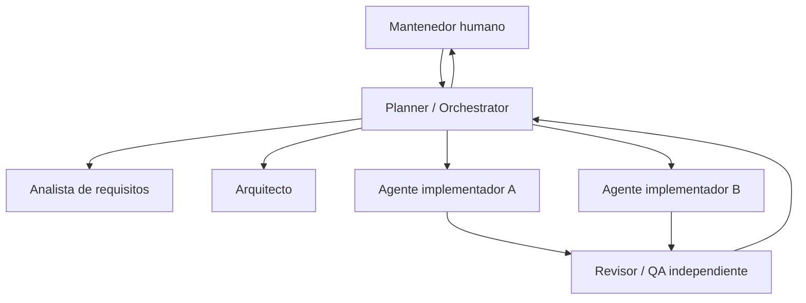

# Modelo operativo de desarrollo agéntico

**Objeto:** sistema de trabajo para múltiples agentes de IA con un agente de planificación y revisores independientes.

## Topología de responsabilidad

El Planner posee calendario, prioridades, bloqueos y registro. Cada agente conserva expediente de su tarea con fuentes, entradas, outputs y pruebas. Las ramas de tareas contienen la implementación; el registro global se integra por el Planner, nunca por escrituras concurrentes.

## Contratos de asignación

Cada `TASK` tiene: ID, owner, alcance permitido, WBS, REQ, ADR relevantes, contexto no confiable identificado, rutas editables y prohibidas, dependencias, criterio de aceptación, pruebas, fecha objetivo si es aprobada, condiciones de parada y formato del reporte. El Planner registra una reserva explícita de rutas. Prohibido lanzar dos tareas con escritura sobre el mismo archivo compartido sin serializarlas.

## Flujo

1. **Intake:** solicitud o hallazgo → nueva RR o ticket candidato → deduplicación y prioridad.
2. **Plan:** Planner evalúa SRS, WBS, seguridad, costo, dependencias y riesgo; define tareas lo bastante pequeñas.
3. **Decisión:** analista produce RR; arquitecto propone ADR si afecta decisión técnica importante; aprobación humana cuando aplica.
4. **Dispatch:** crear rama/worktree exclusivos, reservar rutas y registrar la asignación.
5. **Implement:** agente desarrolla en su worktree, pruebas verificadas, documentación y evidencia.
6. **Review:** QA independiente valida especificación, seguridad, comportamiento y cobertura; nunca autoaprobar.
7. **Integrate:** Planner revisa colisiones, actualiza requisitos y trazabilidad, y propone PR para aprobación humana.
8. **Close:** sólo tras aceptación documentada, se actualiza estado; limpiar worktrees después de fusionar y guardar evidencias.

## Concurrencia segura y recuperación

Evitar compartir archivos de infraestructura de raíz entre implementadores. Cuando un cambio transversal sea inevitable, reservarlo al agente arquitecto o dividirlo en dos PR secuenciales. Ramas de larga vida requieren rebase/merge controlado. Un agente caído deja tarea `blocked`; el Planner revalida estado de branch, tests y commit antes de reasignar. Nunca considerar trabajo aceptado por la sola existencia de un PR.

## Memoria y centralización

`docs/agents/REGISTRY.md` contiene quién trabaja en qué; `docs/agents/runs/TEMPLATE.md` define el registro por ejecución; los hallazgos duraderos se transfieren a `SRS`, `RR` o `ADR`. No depender de memoria de chat ni de prompts efímeros para decisiones. El registro no debe almacenar secretos ni identificadores personales innecesarios.

## Gobernanza

Los agentes pueden proponer cambios, no autorizar cambios de baseline, derechos de acceso, borrado de datos, contratos externos ni gastos. Consultar `AGENTS.md` y `docs/quality/DEFINITION_OF_DONE.md`.
