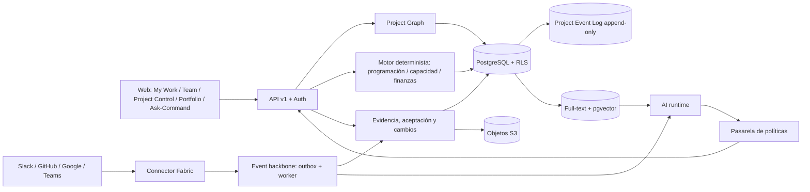

# Arquitectura de referencia — Alaira Planner

**Estado:** diseño vigente; implementa la definición del [PRODUCT_BRIEF](../product/PRODUCT_BRIEF.md) sobre las decisiones de [ADR-0003](adr/0003-modular-monolith-candidate.md) (monolito modular con outbox), [ADR-0005](adr/0005-agent-tools-policy-gate.md) (IA transaccional), [ADR-0006](adr/0006-stack-base.md) (stack) y [ADR-0007](adr/0007-tenancy-y-autenticacion.md) (tenancy y autenticación). Los ADR 0003, 0005, 0006 y 0007 están aceptados con la condición de que TASK-0002 los valide. **No hay código ni despliegue todavía.**

## Drivers arquitectónicos

- **Cuatro verdades separadas:** proyecto (grafo y estados), ejecución (evidencia externa), finanzas (presupuesto, costo real, compromisos) e IA transaccional, que propone sobre las otras tres sin sustituirlas.
- Consistencia en transiciones de negocio (aceptación, baseline, costo).
- Motor determinista como autoridad (NFR-021).
- Portabilidad OSS y autoalojamiento.
- Aislamiento multi-tenant y auditoría append-only.
- Extensibilidad de conectores.
- Frescura de evidencia (NFR-022).
- Desarrollo incremental por varios agentes.

## Vista lógica

Los diagramas son lógicos.

## Módulos y autoridad sobre los datos

| Módulo | Autoridad sobre el dato | Contrato |
|---|---|---|
| IAM/Tenant | membresías, políticas, sesiones | identidad y autorización central (ADR-0007) |
| Project Graph | Work Nodes, aristas, `delivery_profile`, ownership | comandos de negocio y eventos |
| Planning engine | calendarios, red, CPM, nivelación, baselines, forecast determinista | plan validado e instantáneas reproducibles |
| Capacity | personas, equipos, capacidad, recursos no humanos | disponibilidad y sobrecarga calculadas |
| Agile | iteraciones, backlog, estados, métricas | proyecciones sobre los mismos Work Nodes |
| Evidence & Review | EvidenceEvent, vínculos, criterios, aceptación, cambios | transiciones auditadas |
| Finance | presupuesto, costo real, compromisos, EV/PV, aprobaciones | números reproducibles |
| Connector Fabric | conexiones, grants, mapeos, eventos normalizados, deduplicación | Connector SDK (capa anticorrupción) |
| AI runtime | conversaciones, AIProposal, evaluaciones | herramientas tipadas tras la pasarela de políticas (ADR-0005) |
| Reporting | proyecciones de control tower y portafolio | lecturas derivadas con fecha de corte |

No hay transacción distribuida en el camino de aceptar un entregable. Las integraciones externas operan con reintentos y compensación; una notificación fallida nunca revierte una aceptación legítima.

## Event backbone

Cada mutación de dominio escribe en la misma transacción su evento de dominio y el registro del outbox. El worker publica hacia conectores, AI runtime y proyecciones con reintentos, backoff y cola de fallos. Los eventos de conectores entran como **EvidenceEvent** normalizados (`artifact.lifecycle.changed`, `user.intent.received`, `artifact.activity.detected`; ver [INTEGRATIONS](INTEGRATIONS.md)) con clave de deduplicación por fuente. Contrato con `schema_version` y compatibilidad hacia atrás.

## AI runtime

Seis pasos (ADR-0005): **Observe** (evento o petición) → **Retrieve context** (grafo, permisos, documentos, historial; filtrado por tenant y permisos **antes** de recuperar) → **Interpret** (intención y entidades) → **Plan action** (comandos tipados) → **Policy / authorization** (actor, scopes, nivel de autonomía, versión) → **Execute + verify** (vía API de dominio, verificación del estado resultante y respuesta con consecuencias). El resultado queda como AIProposal o como cambio aplicado, siempre con trazabilidad completa en el Project Event Log (REQ-091).

## Frontera determinista / probabilística (NFR-021)

| Determinista: autoridad | Probabilístico: IA |
|---|---|
| fechas, calendarios, dependencias, ruta crítica | interpretar lenguaje natural |
| capacidad y sobrecarga | vincular evidencia con ítems (IA + reglas) |
| costo, saldo, EV/PV/AC, forecast determinista | resumir y explicar |
| baseline y estados | proponer riesgos, avance y replanificación |
| permisos y transacciones | redactar stand-ups y reportes |
| aprobaciones contractuales: siempre humanas | — |

El forecast probabilístico (Monte Carlo, M5) es un cálculo estadístico reproducible con semilla, no una salida del LLM.

## Persistencia

PostgreSQL es la fuente transaccional única: tablas de nodos y aristas (`work_node`, `dependency_edge`, `hierarchy_edge`, `artifact_link`, `goal_link`), RLS por `tenant_id`, eventos append-only, full-text e índice vectorial `pgvector`. Las evidencias binarias van a almacenamiento S3. Un almacén analítico separado solo entra por ADR cuando la medición lo exija (WBS-6.4).

## Reglas técnicas

**Comandos:** identidad, tenant y permisos → estado y versión → transacción de dominio con outbox → respuesta estable → publicación eventual. Operaciones sensibles con aprobación y clave idempotente.

**Versionado:** API `/api/v1`, eventos con `schema_version`, migraciones `up`/`down` (NFR-012) y relectura de eventos.

**Consistencia:** finanzas y decisiones dentro de límites transaccionales; las sincronizaciones se reconcilian de forma asíncrona y la UI muestra «pendiente de sincronizar» en lugar de simular confirmación.

**Seguridad:** deny by default; el servidor es el punto de enforcement; OAuth con permisos mínimos y verificación de firmas; el LLM nunca valida de forma final; contenido externo tratado como entrada hostil ([SECURITY_PRIVACY](SECURITY_PRIVACY.md)).

## Despliegue de referencia

Docker Compose con API, worker, web, PostgreSQL y almacenamiento S3 local (ADR-0006). Ambientes local, CI, staging y producción; secretos fuera del repositorio; migración y rollback; backups restaurados y ensayados antes del primer piloto (NFR-009); telemetría, alertas, colas de fallos, SLO y runbooks (WBS-8.4).

## Evolución por cortes

| Corte | Arquitectura que entra |
|---|---|
| M1 | kernel completo: tenancy y RLS, Project Graph, motor de programación, evidencia y aceptación, event log, Connector Fabric con Slack y GitHub, AI runtime con pasarela de políticas, UI mínima |
| M2 | módulo Agile e híbrido sobre los mismos Work Nodes; conector de Google Workspace; stand-up asíncrono |
| M3 | módulo Finance y EV/PV/AC |
| M4 | proyecciones de control tower, portafolio y RAID; suscripciones salientes; evaluación de GraphQL |
| M5 | gobierno enterprise, forecast probabilístico y conector de Microsoft 365 / Teams |

## ADRs pendientes

Se deciden antes de la capacidad que los requiere: fórmula de EVM y reglas de costos (antes de M3), política de privacidad y retención (antes del primer piloto, OQ-08), forma de la oferta empresarial (OQ-11) y cualquier cambio a la tabla de ADR-0006.
