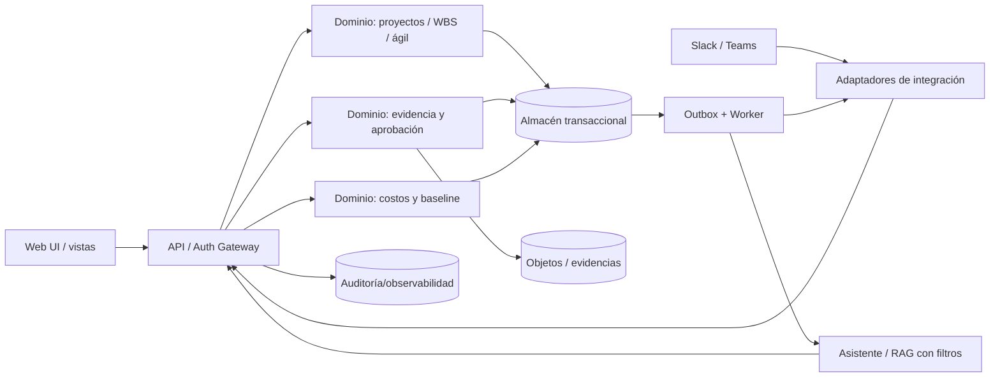

# Arquitectura de referencia — Alaira Planner

**Estado:** propuesta; no hay tecnología ni despliegue aprobados. **No constituye ADR aceptado.**

## Drivers arquitectónicos

Consistencia en transiciones de negocio (aceptación, baseline, costo), portabilidad OSS, desarrollo incremental por agentes, aislamiento multi-tenant, auditoría, extensibilidad de conectores y rendimiento de vistas de proyecto.

## Arquitectura candidata

La opción inicialmente preferida para validar es **monolito modular con trabajos asíncronos y APIs**, no microservicios por defecto. Los límites de módulos reflejan el dominio de `DOMAIN_MODEL.md`. Evaluar también backend modular distribuido y patrón event-sourced completo antes de decidir con ADR. Se propone una fuente transaccional para reglas críticas, cola/outbox para conectores/IA y almacenamiento de objetos para evidencias, con índices derivados para búsqueda y proyecciones. No elegir motor concreto por intuición.

Los diagramas son lógicos; líneas no garantizan implementación ni obligatoriedad de un proveedor.

## Módulos y límites

| Módulo | Autoridad sobre dato | Contrato |
|---|---|---|
| IAM/Tenant | membresías, políticas, sesiones | identidad y autorización central |
| Project & Work | jerarquía, ownership, tareas, entregables | comandos de negocio y eventos |
| Planning | calendario, red, baseline, cambios | plan validado e instantáneas |
| Agile | iteraciones, backlog, estados | proyecciones coherentes de trabajo |
| Evidence & Review | fuentes, criterios, aceptación | transiciones auditadas |
| Finance | presupuesto, AC, EV/PV, aprobaciones | números reproducibles |
| Integrations | conectores, grants, sync, dedup | anti-corruption layer |
| AI | consultas, citas, sugerencias y herramientas | policy enforcement delegado |
| Reporting | consultas/indicadores multi-nivel | lecturas derivadas con fecha de corte |

No realizar transacción distribuida dentro del camino de aceptar entregable si puede evitarse. Integraciones externas operan con reintentos y compensación; una notificación fallida nunca revierte una aceptación legítima sin política explícita.

## Reglas técnicas

**Comandos:** validar identidad/tenant/permisos → validación de estado/versión → transacción del dominio y outbox → respuesta estable → publicación eventual. Operaciones sensibles requieren aprobación y claves idempotentes.

**Versionado:** API `/v1`, contrato de eventos con `schema_version`, estrategia de compatibilidad hacia atrás, migraciones de base y relectura de eventos. Compatibilidad específica se determina por ADR.

**Consistencia:** datos financieros y decisiones dentro de límites transaccionales; sincronizaciones se reconcilian de manera asíncrona. Mostrar «pendiente de sincronizar» en lugar de simular actualización inmediata confirmada.

**Seguridad:** deny by default, servidor como enforcement point, OAuth mínimos permisos y verificación de firmas; no confiar en un LLM para validación final; cifrado, rotación, observabilidad y límites de conexión.

**IA:** el LLM puede resumir/citar/proponer; acciones pasan por herramientas tipadas que ejecutan las mismas reglas de dominio que la UI. RAG incluye control de acceso antes de recuperar fragmentos, no sólo filtrar al final. Prompt injection se trata como entrada hostil.

## Despliegue de referencia (a decidir)

Ambientes local, CI, staging y producción; contenedores o método reproducible; variables/secrets sin comprometer repo; migración y rollback; backups restaurados y ensayados; telemetría, alertas, colas de fallos, SLO y runbooks. La opción de self-hosting OSS exige no atarse a proveedor único.

## Evolución

1. M0: validar bounded contexts, threat model y pruebas de concepto para CPM/EV y sync.
2. M1: transacciones + auditoría + API + evidencia/aceptación + UI.
3. M2/M3: planning/agile como módulos, no duplicaciones de trabajo.
4. M4: adaptadores externos con outbox y reintentos.
5. M5: finanzas y predicción como módulos con pruebas deterministas primero.

## ADRs obligatorios antes de implementación

Stack/runtime, DB/tenancy, auth/OAuth, object storage, eventos/outbox, licencia, hosting y autoservicio, reglas progreso aceptado, fórmula EVA/EVM y alcance de IA. Propuestas se elevan en `adr/`. No atribuir decisiones definitivas a este documento.
