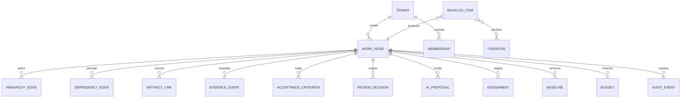

# Modelo de dominio y reglas de integridad

**Estado:** conceptual; todavía no existen migraciones ni tablas. Implementa el *Project Graph* del [PRODUCT_BRIEF](../product/PRODUCT_BRIEF.md) para que predictivo, ágil e híbrido sean vistas del mismo trabajo y no silos.

## Project Graph

Todo el trabajo es un **Work Node** con tipo, conectado por aristas:

| Arista | Significado |
|---|---|
| `hierarchy_edge` | descomposición: Portfolio → Program → Project → Phase/Release → Deliverable/Work Package → Work Item |
| `dependency_edge` | FS/SS/FF/SF con *lag* en unidades explícitas; también entre proyectos (REQ-030) |
| `artifact_link` | vínculo de un nodo con un artefacto externo (PR, issue, documento, hilo) |
| `goal_link` | contribución a objetivos, OKR o beneficios |
| `ownership` | responsable, aprobador y equipo |
| `assignment` | persona o rol asignado con capacidad |
| `evidence` | EvidenceEvent que respalda un nodo |

Tipos de Work Node: objetivo, proyecto, fase, entregable, paquete de trabajo, épica, historia, tarea, bug, riesgo, decisión, solicitud de cambio, hito.

**`delivery_profile`.** Cada proyecto declara su perfil y cada rama del grafo puede sobrescribir el modo de ejecución (REQ-081):

```json
{ "planning_mode": "hybrid", "schedule_engine": true, "agile_execution": true,
  "financial_control": "full", "resource_planning": true, "baseline_required": true }
```

`planning_mode` admite predictivo, Scrum, Kanban o híbrido. Ejemplo: Plataforma 2.0 es híbrida; Arquitectura y Seguridad, predictivas; Backend y Frontend, Scrum; Despliegue, predictivo con *gate*. Cambiar de perfil no duplica trabajo.

## Bounded contexts

- **Identity & Tenancy:** Tenant, User, Membership, Role, Policy, ServicePrincipal, ConnectorIdentity (ADR-0007).
- **Project Graph:** WorkNode, HierarchyEdge, DependencyEdge, GoalLink, DeliveryProfile, Team, Assignment, Skill.
- **Planning:** Calendar, CalendarException, Estimate, Schedule, Baseline, BaselineSnapshot, Forecast, Scenario, ChangeRequest.
- **Capacity:** Person, Team, CapacitySlot, Absence, NonHumanResource (sala, equipo, licencia, proveedor, material).
- **Agile:** BacklogItem (proyección de WorkNode), Iteration, WorkflowState, WipLimit, Release, ItemTransition.
- **Evidence & Acceptance:** EvidenceEvent, ArtifactLink, ArtifactVersion, AcceptanceCriterion, CompletionRequest, ReviewDecision, ProgressStrategy, ProgressEvent.
- **Finance:** Budget, BudgetLine, RateCard, CostEntry, Commitment, Invoice, FinancialBaseline, EvmSnapshot, CurrencyRate.
- **Connectors & AI:** Connection, ConnectionGrant, ExternalIdentity, SyncCheckpoint, IdempotencyKey, AIProposal, ApprovalRequest, Citation, AuditEvent.

## Relación estructural



El diagrama es conceptual; el esquema físico se fija en la TASK que lo introduce, dentro de ADR-0006 y ADR-0007.

## Objetos clave

**EvidenceEvent.** Hecho externo normalizado: fuente, tipo de evento, actor externo y su identidad resuelta, artefacto y versión, instante, clave de deduplicación, nodos vinculados con confianza y método (regla o IA), y estado del vínculo (propuesto, confirmado, rechazado). No cambia avance ni estado por sí mismo.

**AIProposal.** Cambio propuesto por la IA: comando tipado, nodo destino, estado anterior y propuesto, evidencia citada, criterios cumplidos y pendientes, consecuencias calculadas por el motor, nivel de autonomía, modelo o regla, y resolución (aplicada, confirmada, rechazada o expirada) con actor y momento (REQ-090–092).

**ProgressStrategy.** Estrategia versionada por paquete (REQ-095): manual, por duración, por trabajo, % físico, hitos ponderados, checklist ponderado, aceptación de entregable (0/100), completitud de historias, técnica de valor ganado (por ejemplo 50/50) y evidencia externa con confirmación. Indica si cuenta como técnica de valor ganado.

## Invariantes

1. Toda entidad de negocio tiene `tenant_id`, ID estable con prefijo (ADR-0007), versión para concurrencia optimista y `created_at`. El `tenant_id` aportado por el cliente nunca autoriza.
2. `hierarchy_edge` no forma ciclos; un nodo tiene un único padre jerárquico.
3. Una dependencia une nodos existentes y visibles, prohíbe la autorreferencia y rechaza los ciclos.
4. Los hitos son nodos de duración cero; la aceptación de un hito y la de sus entregables son eventos independientes.
5. Un EvidenceEvent es procedencia, no verdad: un checksum aporta integridad de bytes pero no autenticidad, y un PR mergeado no prueba que el trabajo cumpla su DoD.
6. `CompletionRequest` no significa `Accepted`. Cada decisión añade `ReviewDecision` y `AuditEvent`; una reversión añade un evento compensatorio y recalcula sin borrar historia.
7. **Baseline ≠ forecast ≠ real.** Las baselines aprobadas son inmutables; el forecast se recalcula; lo real procede de eventos y costos registrados. Un escenario no modifica la baseline.
8. Todo costo identifica moneda, instante, categoría, tipo de reconocimiento, origen y permiso. Pagado, comprometido y devengado son dimensiones distintas.
9. Las vistas de sprint y WBS se proyectan desde el mismo Work Node; no hay copia de datos entre metodologías.
10. Cada evento externo tiene ID de fuente, clave idempotente, versión y actor resuelto. Un replay no produce una segunda transición de avance, aceptación ni finanzas.
11. Una AIProposal no muta el grafo: se aplica como comando de dominio tras la pasarela de políticas (ADR-0005) y nunca cierra un nodo con criterios pendientes.

## Avance

Política aprobada en [RR-0002 §4](../requirements/records/RR-0002-baseline-m1-y-g0.md): estrategia por paquete, propuestas de IA con evidencia y criterios, agregación por hojas únicas con pesos versionados, y valor ganado solo con técnicas declaradas.

**Ejemplo sin doble conteo.** El paquete A (peso 3) tiene su entregable aceptado; el paquete B (peso 2) está pendiente y tiene tres PR mergeados sin aceptar. Avance del padre = 3 / (3 + 2) = 60 %. Los PR no cambian el numerador; como mucho generan una AIProposal para B. Si se revierte la aceptación de A, el avance vuelve a 0 %.

## Eventos de dominio

`ProjectCreated`, `WorkNodeDefined`, `DeliveryProfileChanged`, `EvidenceReceived`, `EvidenceLinked`, `AIProposalCreated`, `AIProposalResolved`, `CompletionRequested`, `DeliverableAccepted`, `DeliverableRejected`, `AcceptanceReversed`, `BaselineApproved`, `ChangeApproved`, `CostRecognized`, `ConnectorDisconnected`. Todos llevan `event_id`, `tenant_id`, `aggregate_id`, `occurred_at`, `actor_id`, `correlation_id`, `causation_id` y `schema_version`, con minimización de datos.

## Decisiones

**Resueltas:**

- Claves y tenancy, por ADR-0007.
- Relación entre WBS y work items: son el mismo Work Node con proyecciones distintas.
- Política de avance, por RR-0002.

**Abiertas, a decidir en la TASK correspondiente:**

- Propiedad de los calendarios (organización, equipo o persona).
- Catálogo de unidades.
- Formato de importación.
- Retención de evidencias, ligada a OQ-08.
- Resolución de conflictos de sincronización bidireccional.
