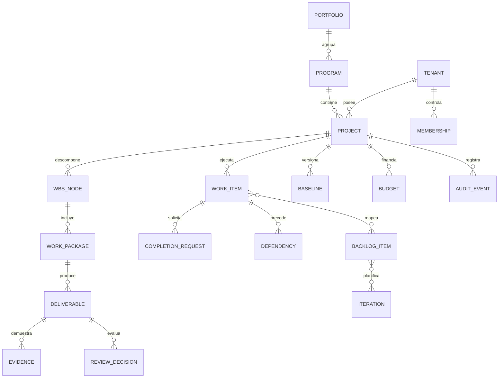

# Modelo de dominio y reglas de integridad

**Estado:** conceptual (no migraciones ni tablas existentes). Diseñado para evitar silos entre predictivo, ágil e híbrido.

## Bounded contexts

**Identity & Tenancy:** Tenant, User, Membership, Role, Policy, ServicePrincipal, ConnectorIdentity.

**Portfolio & Project:** Portfolio, Program, Project, Phase, Objective, WorkItem, WorkPackage, Deliverable, Milestone, Team, Assignment, Skill, CapacitySlot.

**Planning:** WbsNode, Dependency, Calendar, CalendarException, Estimate, Schedule, Baseline, BaselineSnapshot, Scenario, ChangeRequest, ResourceAllocation.

**Agile:** BacklogItem, Epic, Iteration, WorkflowState, WipLimit, Release, ItemTransition.

**Evidence & Acceptance:** Evidence, ArtifactVersion, CompletionRequest, AcceptanceCriterion, ReviewDecision, ProgressEvent, ProgressPolicy.

**Finance:** Budget, BudgetLine, RateCard, CostEntry, CostCommitment, FinancialBaseline, EvmSnapshot, CurrencyRate.

**Integration & Intelligence:** Connector, ConnectionGrant, ExternalReference, WebhookDelivery, IdempotencyKey, SyncCheckpoint, AIRecommendation, ApprovalRequest, Citation, AuditEvent.

## Relación estructural

El diagrama es intencionalmente conceptual: las cardinalidades y el tratamiento de relaciones m:n se especificarán al cerrar ADR de almacenamiento. No suponer que WBS_NODE y WORK_PACKAGE deben ser tablas separadas.

## Invariantes estructurales

1. Entidades de negocio almacenan `tenant_id`, `id` estable, versión/concurrencia optimista, `created_at` y control de permisos. No confiar en `tenant_id` aportado por el cliente como autorización.
2. Jerarquías WBS no contienen ciclos; un elemento terminal puede mapearse a varios backlog items, pero las asignaciones de peso evitan doble conteo. El agregado usa objetos/relaciones versionados.
3. Dependencia enlaza origen/destino existentes, respeta permisos, prohíbe autorreferencia y detecta ciclos para programación; tipo FS/SS/FF/SF y `lag` con unidades explícitas.
4. Los hitos son resultados de duración cero; aceptación de hito y aceptación de entregables son eventos independientes.
5. `Evidence` es un registro de procedencia y revisión; un artefacto mutable tiene versiones. Un checksum aporta integridad de bytes pero no autenticidad del contenido.
6. `CompletionRequest` no significa `Accepted`. Toda decisión añade `ReviewDecision` y `AuditEvent`; una reversión agrega evento compensatorio y recalcula estado sin borrar eventos.
7. Baselines aprobadas son inmutables; un cambio genera nueva versión con referencia a solicitud y aprobador. Escenario no modifica baseline.
8. Todos los costos identifican moneda, instante, tipo de costo, reconocimiento, origen y permiso. Pagado, comprometido y devengado son dimensiones diferentes.
9. Los estados de sprint y de WBS se proyectan desde trabajo canónico y mapping controlado. No derivar porcentaje como suma de acciones sin ponderación.
10. Cada evento externo tiene identificador de fuente, clave idempotente, versión y actor resuelto. Replay no debe producir una segunda transición financiera o de aceptación.

## Reglas de avance sugeridas para discusión

Para entregables discretos: 0% pendiente, 100% aceptado; puede existir estado intermedio informativo no computado como EV. Para trabajo de duración medible: política explícita de porcentaje (por ejemplo 0/50/100, hitos ponderados o progreso manual validado) aprobada por el PM y versionada. El progreso de padre se agrega solo sobre sus hojas únicas mediante pesos fijos y el criterio de aceptación; no se introduce porcentaje derivado de volumen de chat/commits.

## Eventos propuestos

`ProjectCreated`, `WorkPackageDefined`, `EvidenceAttached`, `CompletionRequested`, `DeliverableAccepted`, `DeliverableRejected`, `AcceptanceReversed`, `BaselineApproved`, `ChangeApproved`, `CostRecognized`, `ConnectorDisconnected`. Eventos portan `event_id`, `tenant_id`, `aggregate_id`, `occurred_at`, `actor_id`, `correlation_id`, `causation_id`, `schema_version` y minimización de datos.

## Ejemplo de agregación sin dobles conteos

Paquete A peso 3 con entregable aceptado; B peso 2 pendiente y tres evidencias no aceptadas: progreso = 3 / (3+2) = 60%. Las tres evidencias no cambian el numerador. Si A se revierte con permiso, progreso = 0%. Regla de pesos y baseline quedan auditadas.

## Decisiones abiertas

Claves y tenancy físico/lógico; vinculación exacta WorkItem/WbsNode; propiedad de calendario; selección de unidades; compatibilidad con importación; política de evidencias retenidas; versiones de esquema y conflictos de sincronización.
