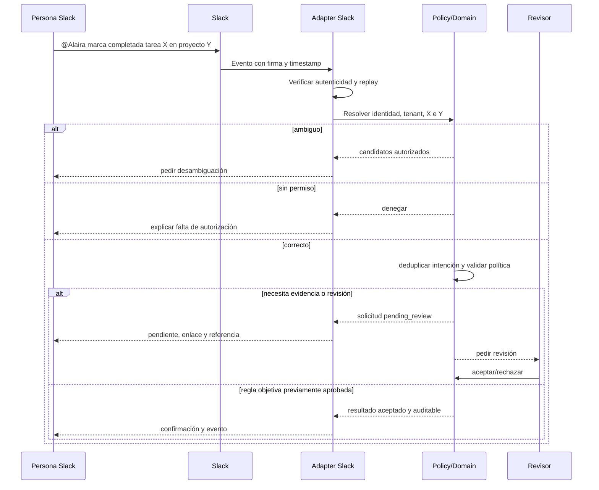

# Contratos de integración, bot y sincronización

**Estado:** diseño vigente; todavía no hay API implementada. **Responsable futuro:** Connector Fabric + Security. **Requisitos:** REQ-061–065, REQ-087–089, REQ-093, NFR-001, NFR-007, NFR-008, NFR-017, NFR-022. **ADR:** [ADR-0003](adr/0003-modular-monolith-candidate.md), [ADR-0005](adr/0005-agent-tools-policy-gate.md), [ADR-0006](adr/0006-stack-base.md).

## 1. Filosofía

El núcleo conserva la autoridad sobre el grafo de proyecto, la evidencia, las aprobaciones y la baseline. Slack, GitHub, Google Workspace, Microsoft 365, hojas de cálculo y demás fuentes son **adaptadores** que entregan hechos e intenciones con procedencia. Un hecho externo se convierte en EvidenceEvent; puede originar una AIProposal, pero nunca cambia avance ni estado por sí solo.

## 2. Connector SDK

Todo conector implementa el mismo contrato en `packages/connectors` (ADR-0006):

| Operación | Responsabilidad |
|---|---|
| `authorize` / `revoke` | OAuth con permisos mínimos; revocación completa y auditada |
| `subscribe` | registrar webhooks o eventos dentro de los términos del proveedor |
| `backfill` | importar el historial autorizado con límites de tasa |
| `receive_event` | verificar firma, timestamp y replay; registrar la recepción |
| `normalize` | traducir a eventos normalizados (§3) |
| `resolve_identity` | asociar el actor externo con un usuario del tenant; si no hay mapeo, no se atribuye |
| `fetch_artifact` | leer el artefacto respetando la ACL externa |
| `execute_action` | ejecutar una acción externa autorizada (responder, comentar, enlazar) |
| `health_check` | estado `connected`, `degraded`, `disconnected` o `revoked`, con último sync y retraso |

## 3. Eventos normalizados

| Evento | Significado | Ejemplos |
|---|---|---|
| `artifact.lifecycle.changed` | un artefacto cambia de estado | PR abierto, revisado o mergeado; issue cerrado; documento aprobado |
| `user.intent.received` | una persona pide algo a Alaira | «@Alaira marca la tarea X como completada» |
| `artifact.activity.detected` | actividad sin cambio de estado | commits, comentarios, ediciones |

Solo `artifact.lifecycle.changed` y `user.intent.received` pueden originar propuestas de avance. `artifact.activity.detected` alimenta frescura y contexto, nunca porcentajes (REQ-087).

## 4. Superficies, mapeos y corte

| Integración | Lectura | Escritura | Mapeo al grafo | Corte |
|---|---|---|---|---|
| Slack | menciones y eventos de canales autorizados | respuestas con consecuencias, solicitudes de completar, stand-up | intención → comando tipado vía AI runtime | M1 |
| GitHub | repos, PR, issues, revisiones, checks autorizados | comentarios y enlaces opcionales | PR → `artifact_link` de un Work Item; merge y checks → EvidenceEvent y AIProposal de avance (REQ-088) | M1 |
| API v1 / webhooks entrantes | recursos según scopes | comandos tipados | directo al dominio | M1 (suscripciones salientes: M4) |
| CSV / hoja de cálculo | tareas, costos, calendarios | exportación de estado | importación validada | M1 |
| Google Workspace | Drive/Docs con ACL, Calendar | asociación de evidencia | documento aprobado → EvidenceEvent de un entregable; Calendar → ausencias de capacidad (REQ-089) | M2 |
| Microsoft 365 / Teams | mensajes, documentos y calendarios con consentimiento organizacional | respuestas y solicitudes | equivalentes a Slack y Google | M5 (REQ-062, P2) |
| Jira, GitLab, Linear, Figma y otros | según conector | según conector | según conector | posteriores (OQ-10) |

El corte sigue el [ROADMAP](../planning/ROADMAP.md). Ninguna integración lee todo el workspace por defecto.

## 5. Respuestas con consecuencias (REQ-093)

Una respuesta de Alaira en un canal nunca es solo «hecho». Muestra el estado real y lo que cambió:

> Diseño de API de pagos marcado como completado. Final real: 16 oct. El hito API Freeze sigue previsto para el 19 oct. No cambia la ruta crítica. Registrado a partir de tu instrucción en Slack.

> Encontré evidencia de que el código fue integrado, pero falta la prueba de seguridad requerida. Propongo actualizar el progreso a 85 %, no cerrar la tarea.

Si la acción quedó pendiente de revisión, se dice así, con enlace y referencia; si falló, se explica por qué y cuál es el trámite manual.

## 6. Contrato público conceptual

HTTP API versionada con contrato OpenAPI (ADR-0006). Comandos deben soportar request ID/idempotencia, ETag/versión optimista, actor, tenant derivado de credenciales, correlation ID y respuesta estructurada.

```http
POST /api/v1/projects/{projectId}/work-items/{workItemId}/completion-requests
Authorization: Bearer <token>
Idempotency-Key: <unique-per-actor-intent>
Content-Type: application/json

{
  "evidence_ids": ["ev_123"],
  "comment": "Documento final adjunto",
  "source": "slack",
  "expected_version": 12
}
```

**Respuesta conceptual:** 202 Accepted con `completion_request_id` y estado `pending_review`; **no** `completed` hasta decisión permitida. Para transiciones que la política permita autoaceptar, la respuesta puede indicar `accepted` junto al evento de auditoría y la regla habilitante. Los detalles de rutas son ejemplos, no endpoint implementado.

**Errores:** 400 validación, 401 identidad, 403 permiso, 404 recurso no visible, 409 conflicto de versión, 422 criterios faltantes, 429 rate limit, 503 proveedor; respuestas no revelan existencia de objetos de otros tenants.

## 7. Flujo Slack — comando crítico

El flujo detallado, con los pasos del AI runtime, está en [SLACK_BOT_FLOW](../examples/SLACK_BOT_FLOW.md).



Responder al proveedor en la ventana requerida por su protocolo, desacoplar trabajo lento de la entrega del evento y no confiar en nombre visible de usuario. Autenticidad del webhook no equivale a autorización del actor.

## 8. Idempotencia, sincronización y conflictos

El adaptador guarda `provider`, `event_id`, `delivery_id`, `resource_id`, `external_version`, `tenant_id`, `received_at` y hash normalizado. Registrar receipt, procesar mediante cola durable y outbox, asegurar que mismo evento/clave no genere segunda acción. Distinguir retry técnico de nueva intención legítima. Propagación bidireccional debe usar marcadores de origen y versión para evitar bucles; política de conflictos definida por campo, nunca «last write wins» indiscriminado para aceptaciones/costos.

Conectores deben soportar `connected/degraded/disconnected/revoked`, última sincronización exitosa, retraso, errores reparables, retry con backoff/jitter, DLQ y replay auditado. Descubrimiento de cambios por webhook o polling sólo dentro de términos y rate limits del proveedor.

## 9. Seguridad y evaluación

Validación de firma/timestamp según documentación oficial de cada proveedor, OAuth/PKCE/scopes y revocación, cifrado de tokens, control de ACL externa para evidencia enlazada, validación de callback, SSRF protegido. Pruebas: suplantación, replay, evento fuera de orden, ID confuso, usuario sin mapeo, revocación, canal privado, drift de permisos y **vinculación errónea de un PR con una tarea** (TC-EV-04, TC-GH-01). La documentación oficial de Slack y GitHub y las guías OAuth/OWASP se revisan en la TASK que implementa cada conector.
