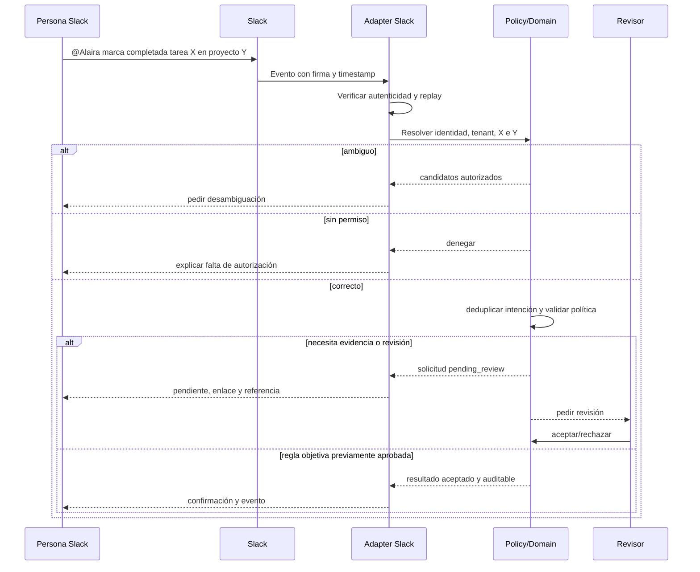

# Contratos de integración, bot y sincronización

**Estado:** diseño propuesto, no API existente. **Responsable futuro:** Integrations + Security. **Requisitos:** REQ-061–070 y NFR-001/007/008/017.

## 1. Filosofía

El núcleo conserva la autoridad sobre Project, WorkItem, Evidence, Approval y Baseline. Slack, Teams, Drive, Microsoft 365, hojas de cálculo, repositorios y otras fuentes son **adaptadores** que entregan señales y solicitudes con procedencia; ninguno se convierte automáticamente en fuente de verdad del avance.

## 2. Superficies y permisos

| Integración candidata | Lectura | Escritura | Alcance mínimo | Fase |
|---|---|---|---|---|
| Slack | eventos/menciones permitidos | respuesta al usuario / solicitud de completar | workspace/usuarios vinculados, sólo canales autorizados | M4 |
| Microsoft Teams | mensajes/interacciones autorizados | respuestas/solicitud | consentimientos organizacionales | P2 |
| GitHub | issues/PR/commits autorizados | vínculos/notificaciones opcionales | repos y eventos autorizados | P1/P2 |
| Google Drive/Docs | enlaces/versiones de documentos con ACL | asociación de evidencia | archivos autorizados | M4/P2 |
| Microsoft 365/SharePoint | documentos/calendarios según consentimiento | asociación/sync de datos | mínimo requerido | M4/P2 |
| CSV/hoja de cálculo | tareas, costos, calendarios | export de estado | archivo suministrado y validado | M1/P1 |
| API/webhooks | recursos bajo scopes | comandos tipados | tenant y resource policy | M1–M4 |

Prioridades son hipótesis por validar en discovery. Ninguna integración debe leer todo el workspace por defecto.

## 3. Contrato público conceptual

Versionar HTTP API con esquemas formales (OpenAPI tras ADR). Comandos deben soportar request ID/idempotencia, ETag/versión optimista, actor, tenant derivado de credenciales, correlation ID y respuesta estructurada.

```http
POST /api/v1/projects/{projectId}/work-items/{workItemId}/completion-requests
Authorization: Bearer <token>
Idempotency-Key: <unique-per-actor-intent>
Content-Type: application/json

{
  "evidence_ids": ["ev_123"],
  "comment": "Documento final adjunto",
  "source": "slack",
  "expected_version": 12
}
```

**Respuesta conceptual:** 202 Accepted con `completion_request_id` y estado `pending_review`; **no** `completed` hasta decisión permitida. Para transiciones que la política permita autoaceptar, la respuesta puede indicar `accepted` junto al evento de auditoría y la regla habilitante. Los detalles de rutas son ejemplos, no endpoint implementado.

**Errores:** 400 validación, 401 identidad, 403 permiso, 404 recurso no visible, 409 conflicto de versión, 422 criterios faltantes, 429 rate limit, 503 proveedor; respuestas no revelan existencia de objetos de otros tenants.

## 4. Flujo Slack — comando crítico



Responder al proveedor en la ventana requerida por su protocolo, desacoplar trabajo lento de la entrega del evento y no confiar en nombre visible de usuario. Autenticidad del webhook no equivale a autorización del actor.

## 5. Idempotencia, sincronización y conflictos

El adaptador guarda `provider`, `event_id`, `delivery_id`, `resource_id`, `external_version`, `tenant_id`, `received_at` y hash normalizado. Registrar receipt, procesar mediante cola durable y outbox, asegurar que mismo evento/clave no genere segunda acción. Distinguir retry técnico de nueva intención legítima. Propagación bidireccional debe usar marcadores de origen y versión para evitar bucles; política de conflictos definida por campo, nunca «last write wins» indiscriminado para aceptaciones/costos.

Conectores deben soportar `connected/degraded/disconnected/revoked`, última sincronización exitosa, retraso, errores reparables, retry con backoff/jitter, DLQ y replay auditado. Descubrimiento de cambios por webhook o polling sólo dentro de términos y rate limits del proveedor.

## 6. Seguridad y evaluación

Validación de firma/timestamp según documentación oficial de cada proveedor, OAuth/PKCE/scopes y revocación, cifrado de tokens, control de ACL externa para evidencia enlazada, validación de callback, SSRF protegido. Pruebas: suplantación, replay, evento fuera de orden, ID confuso, usuario sin mapeo, revocación, canal privado y drift de permisos. Fuentes de diseño: documentación oficial de Slack y OAuth/OWASP a revisar en ADR antes de implementación.
