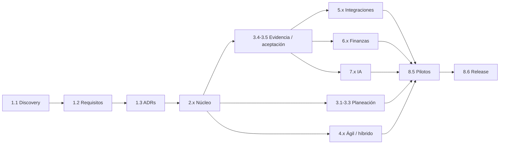

# EDT / WBS — Work Breakdown Structure de Alaira Planner

**Versión 0.1 · Estado:** propuesta inicial por entregables, no una lista de tareas de código. **Dueño:** Planner de Alaira. **Alcance:** creación, verificación y preparación de lanzamiento de una plataforma OSS, no sólo GitHub. **Diccionario:** [WBS_DICTIONARY](WBS_DICTIONARY.md).

## 1. Reglas

La WBS descompone el producto de forma orientada a **resultados aceptables**. Cada hoja posee criterios de aceptación, prueba y evidencia; ninguna se acepta por el número de commits. Los paquetes se asocian a requisitos del SRS. La regla del 100% exige que el alcance de cada padre esté distribuido entre hijos, sin duplicación. Recursos/duración se estiman después de validar el paquete; la existencia de una estimación no implica compromiso.

## 2. Jerarquía de entregables

```text
0.0 Alaira Planner — producto listo para lanzamiento aprobado
  1.0 Fundación, producto y operación agéntica
    1.1 Descubrimiento y validación de necesidades
    1.2 SRS, PRD y línea base de requisitos
    1.3 Arquitectura de referencia y ADRs
    1.4 Flujo de agentes, worktrees, CI y trazabilidad
    1.5 Política OSS, licencia y comunidad
  2.0 Núcleo de plataforma
    2.1 Identidad, organizaciones y sesiones
    2.2 Autorización multi-tenant y políticas
    2.3 Programas, portafolios, proyectos y equipos
    2.4 Auditoría, eventos y persistencia
    2.5 APIs, importación, exportación y búsqueda
    2.6 UX/UI inicial, accesibilidad y vistas base
  3.0 Planificación y aceptación de trabajo
    3.1 Árbol WBS, paquetes, hitos y entregables
    3.2 Calendarios, relaciones y motor de programación
    3.3 Gantt, baseline, escenarios y control de cambios
    3.4 Evidencia universal y procedencia
    3.5 Revisión, aceptación, reversión y progreso
    3.6 Recursos, capacidad y tiempo registrado
  4.0 Agilidad y enfoques híbridos
    4.1 Backlog, épicas, historias y sprints
    4.2 Kanban, WIP y métricas de flujo
    4.3 Fases híbridas, releases, RAID y dashboards
  5.0 Integraciones y colaboración
    5.1 Bot Slack seguro y conversacional
    5.2 Conectores, webhooks y sincronización
    5.3 Notificaciones, prioridades y alertas
  6.0 Finanzas y control
    6.1 Presupuesto, costos, tarifas y aprobaciones
    6.2 EV/PV/AC, indicadores y reportes
    6.3 Escenarios, reservas y forecasting
  7.0 Inteligencia asistiva
    7.1 Recuperación documental y citación por permisos
    7.2 Herramientas de IA y acciones bajo política
    7.3 Evaluación, seguridad y monitoreo de IA
  8.0 Aseguramiento, adopción y lanzamiento
    8.1 Estrategia y automatización de pruebas
    8.2 Seguridad, privacidad y threat modeling
    8.3 Accesibilidad, rendimiento, fiabilidad y observabilidad
    8.4 Documentación, DX y autoalojamiento
    8.5 Pilotos y evidencia de validación de usuarios
    8.6 Release, gobierno y aceptación final
```

## 3. WBS por fases y entregables

| Macroentrega | Paquetes | Evidencia de cierre del padre |
|---|---|---|
| 1.0 | 1.1–1.5 | necesidades trazadas, baseline aprobada, ADRs resueltos y régimen OSS |
| 2.0 | 2.1–2.6 | núcleo desplegable, pruebas de aislamiento, seguridad y navegación |
| 3.0 | 3.1–3.6 | plan, calendarios, evidencia y aceptación verificables |
| 4.0 | 4.1–4.3 | backlog/sprint/Kanban/híbrido sin doble conteo |
| 5.0 | 5.1–5.3 | acciones desde Slack y sync segura con replay |
| 6.0 | 6.1–6.3 | fórmulas y presupuestos reproducibles con corte |
| 7.0 | 7.1–7.3 | respuestas citadas, acciones gobernadas, evals aprobadas |
| 8.0 | 8.1–8.6 | pruebas, documentación, pilotos y gate de release |

## 4. Línea base y progreso del proyecto de construcción

Cada paquete pasa proposed → ready → in_progress → review → accepted. Avance reportado separa: (a) esfuerzo consumido, (b) trabajo implementado, (c) **paquetes aceptados**. Nunca confundirlos. Para roll-up sugerido: peso acordado por paquete; crédito 0 hasta entrega aceptada o política objetiva previamente aprobada; publicar porcentaje y número de paquetes validados. Si se usan hitos parciales ponderados, reflejarlos explícitamente en el diccionario, no ocultarlos en commits.

**Línea base 0:** plan propuesto. El Planner solicita aprobación humana de paquetes, costos estimados, dependencias, criterios y esquema de avance antes de congelarla. Cambios posteriores requieren RR/CR, nueva baseline con historia y análisis de impacto.

## 5. Dependencias principales



En este esquema la precedencia no equivale a imposibilidad de prototipar: discovery, threat model y QA arrancan antes y continúan transversalmente. El orden del roadmap se decide por riesgo y validación, no por el número de paquete.

## 6. Excluidos de esta línea base

ERP completo, nómina, soporte para todas las APIs del mercado, reemplazo binario de Primavera P6/Project, autonomía financiera de agentes, reconocimiento contable legal automático, productividad individual inferida de mensajes. Cualquier incorporación requiere RR y evaluación de costo/valor.
