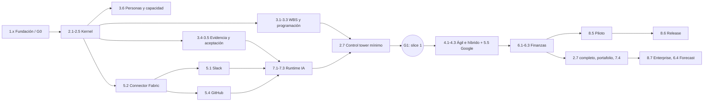

# EDT / WBS — Work Breakdown Structure de Alaira Planner

**Versión 0.2 · Estado:** línea base 0 de alcance aprobada ([RR-0002](../requirements/records/RR-0002-baseline-m1-y-g0.md)); no es compromiso de fechas ni de presupuesto. **Dueño:** Planner de Alaira. **Alcance:** construcción, verificación y lanzamiento del *Project Control Plane* definido en el [PRODUCT_BRIEF](../product/PRODUCT_BRIEF.md). **Diccionario:** [WBS_DICTIONARY](WBS_DICTIONARY.md).

## 1. Reglas

La WBS descompone el producto en **resultados aceptables**. Cada hoja posee criterios de aceptación, prueba y evidencia; ninguna se acepta por el número de commits. Los paquetes se asocian a requisitos del SRS. La regla del 100% exige que el alcance de cada padre esté distribuido entre hijos, sin duplicación. Las estimaciones son hipótesis, no compromisos. La entrega se organiza en *vertical slices* (M1–M5, ver [ROADMAP](ROADMAP.md)): un paquete puede entregarse en partes a lo largo de varios cortes, y cada parte se acepta por separado.

## 2. Jerarquía de entregables

```text
0.0 Alaira Planner — producto listo para lanzamiento aprobado
  1.0 Fundación, producto y operación agéntica
    1.1 Descubrimiento y validación de necesidades
    1.2 SRS, PRD y línea base de requisitos
    1.3 Arquitectura de referencia y ADRs
    1.4 Flujo de agentes, worktrees, CI y trazabilidad
    1.5 Política OSS, licencia y comunidad
  2.0 Núcleo de plataforma (Product Kernel)
    2.1 Identidad, organizaciones y sesiones
    2.2 Autorización multi-tenant y políticas
    2.3 Grafo de proyecto: portafolio, programa, proyecto, work nodes y delivery_profile
    2.4 Auditoría, eventos, Project Event Log y persistencia
    2.5 APIs, importación, exportación y búsqueda
    2.6 Fundamentos de UX, accesibilidad y vistas base
    2.7 Control tower: My Work, Team, Project Control, Portfolio, excepciones y Ask/Command
  3.0 Planificación y aceptación de trabajo
    3.1 Árbol WBS, paquetes, hitos y entregables
    3.2 Calendarios, relaciones, restricciones y motor de programación
    3.3 Gantt, baseline/forecast/real, escenarios y control de cambios
    3.4 Evidencia universal, EvidenceEvent y procedencia
    3.5 Revisión, aceptación, reversión y estrategias de progreso
    3.6 Personas, equipos, recursos, capacidad y tiempo registrado
  4.0 Agilidad y enfoques híbridos
    4.1 Backlog, épicas, historias y sprints
    4.2 Kanban, WIP y métricas de flujo
    4.3 Orquestación híbrida: modos por rama, releases ↔ hitos, RAID
  5.0 Integraciones y colaboración
    5.1 Bot Slack seguro y conversacional
    5.2 Connector Fabric: SDK, OAuth, webhooks, bus de eventos y sincronización
    5.3 Notificaciones, prioridades y alertas
    5.4 Conector GitHub
    5.5 Conector Google Workspace
  6.0 Finanzas y control
    6.1 Presupuesto, costos, tarifas, compromisos y aprobaciones
    6.2 Real, forecast, saldo disponible, EVM, indicadores y reportes
    6.3 Escenarios, reservas, multimoneda y forecasting determinista
    6.4 Analítica histórica y forecasting probabilístico
  7.0 Inteligencia asistiva
    7.1 Recuperación de contexto y citación por permisos
    7.2 Runtime de IA: herramientas tipadas, propuestas y política de autonomía
    7.3 Evaluación, seguridad y monitoreo de IA
    7.4 Agentes funcionales y stand-up asíncrono
  8.0 Aseguramiento, adopción y lanzamiento
    8.1 Estrategia y automatización de pruebas
    8.2 Seguridad, privacidad y threat modeling
    8.3 Accesibilidad, rendimiento, fiabilidad y observabilidad
    8.4 Documentación, DX y autoalojamiento
    8.5 Pilotos y evidencia de validación de usuarios
    8.6 Release, gobierno y aceptación final
    8.7 Gobierno enterprise: SSO/SCIM, retención, residencia y administración
```

## 3. Correspondencia con los paquetes del producto

| Paquete del [PRODUCT_BRIEF](../product/PRODUCT_BRIEF.md) | Paquetes WBS | Corte principal |
|---|---|---|
| WP-A Product Kernel | 2.1–2.5, 3.1 | M1 |
| WP-B Project Graph & Scheduling | 3.2, 3.3 | M1 (restricciones y control de cambios en M2) |
| WP-C Agile Execution | 4.1, 4.2 | M2 |
| WP-D People & Capacity | 3.6 | M1 (asignación y sobreasignación); tiempo y nivelación después |
| WP-E Financial Control | 6.1–6.3 | M3 |
| WP-F Connector Fabric | 5.1, 5.2, 5.4 (M1); 5.5 (M2) | M1–M2 |
| WP-G AI Runtime | 7.1–7.3 | M1 |
| WP-H Control Tower UX | 2.6, 2.7 | M1 mínimo, M4 completo |
| WP-I Hybrid Orchestration | 4.3 | M2 |
| WP-J Portfolio | 2.3 (modelo), 2.7 (vista), 7.4 (agente) | M4 |
| WP-K Enterprise Governance | 2.2, 8.2, 8.7 | transversal; 8.7 en M5 |
| WP-L Analytics & Forecasting | 6.4 | M5 |

Los paquetes 1.x y 8.1–8.6 son de fundación y aseguramiento, sin equivalente directo en el brief.

## 4. Evidencia de cierre de cada macroentrega

| Macroentrega | Paquetes | Evidencia de cierre del padre |
|---|---|---|
| 1.0 | 1.1–1.5 | necesidades trazadas, baseline aprobada, ADRs aceptados y licencia publicada |
| 2.0 | 2.1–2.7 | núcleo desplegable, pruebas de aislamiento, Project Event Log y experiencias por rol operativas |
| 3.0 | 3.1–3.6 | plan, calendarios, baseline/forecast/real, evidencia y aceptación verificables |
| 4.0 | 4.1–4.3 | backlog, sprint, Kanban e híbrido por rama sin doble conteo |
| 5.0 | 5.1–5.5 | Slack, GitHub y Google generan EvidenceEvents seguros, idempotentes y recuperables |
| 6.0 | 6.1–6.4 | fórmulas reproducibles con corte, saldo disponible, holgura y forecast explicable |
| 7.0 | 7.1–7.4 | propuestas citadas, autonomía aplicada, evals aprobadas y agentes operativos |
| 8.0 | 8.1–8.7 | pruebas, documentación, pilotos, gobierno enterprise y gate de release |

## 5. Línea base y progreso del proyecto de construcción

Cada paquete pasa proposed → ready → in_progress → review → accepted. El avance reportado separa (a) esfuerzo consumido, (b) trabajo implementado y (c) **paquetes aceptados**; nunca se confunden. Roll-up: peso acordado por paquete; crédito 0 hasta entrega aceptada; si un paquete se entrega por cortes, cada parte tiene su peso declarado en el diccionario. Publicar porcentaje y número de paquetes validados.

**Línea base 0:** aprobada en [RR-0002](../requirements/records/RR-0002-baseline-m1-y-g0.md) como baseline de **alcance** (estructura, criterios, dependencias y esquema de avance). Los rangos de esfuerzo siguen siendo hipótesis y no constituyen presupuesto. Cambios posteriores requieren RR, nueva versión con historia y análisis de impacto.

## 6. Dependencias principales



Discovery, threat model y QA arrancan antes y continúan de forma transversal. El orden lo deciden el riesgo y la tesis del producto, no el número de paquete.

## 7. Excluidos

ERP completo, nómina, veinte integraciones superficiales, reemplazo binario de Primavera P6 o Microsoft Project, autonomía de agentes sobre baseline, presupuesto o cambios contractuales, reconocimiento contable legal automático y productividad individual inferida de mensajes o commits. Cualquier incorporación requiere RR y evaluación de costo y valor.
