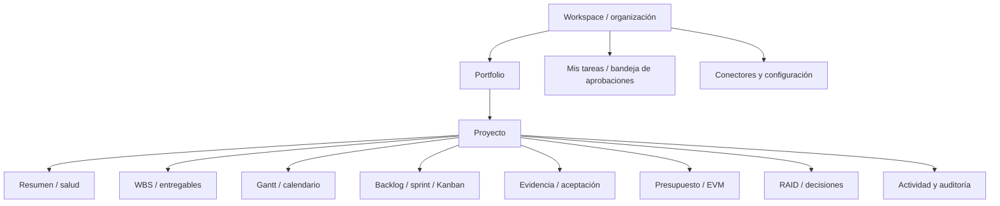

# UX/UI y arquitectura de información de Alaira Planner

**Estado:** guía de diseño conceptual, no pantallas implementadas. La interfaz importa para adopción, pero la diferenciación depende de reglas de producto y fiabilidad.

## 1. Principios

**Orientación al trabajo:** el mismo objeto de proyecto debe expresarse como WBS, Gantt, tabla, board, calendario, dashboard o chat sin cambiar su identidad canónica. **Revelación progresiva:** mostrar primero lo necesario para el rol/metodología, mantener disponible el detalle técnico. **Acciones con consecuencia visible:** toda aceptación, aprobación, cambio de baseline o ejecución asistida presenta quién puede actuar y qué cambiará. **Confianza:** distinguir «actividad», «solicitud de finalizar», «aceptado», «sincronización pendiente» y «predicción».

## 2. Estructura de navegación candidata

La navegación cambia priorización según rol, no cambia permisología del backend. Un PM predictivo aterriza en EDT/Gantt; PO en backlog; contribuyente en mis tareas/evidencias; finanzas en presupuesto. Un proyecto híbrido muestra fases y entrega, con drill-down a iteraciones.

## 3. Vistas y microinteracciones necesarias

| Vista | Señales esenciales | Riesgo de UX |
|---|---|---|
| Organización | selector tenant, permisos, invitaciones | confundir acceso de organizaciones |
| Portfolio | salud, costos y fechas con fecha de corte | suma no comparable entre proyectos |
| Proyecto | nombre, metodología, objetivos, hitos, desviación, dependencias | ocultar baseline |
| WBS | árbol, peso, entregable, estado, responsable, aceptación | aparentar progreso desde subtareas |
| Gantt | fechas, feriados, ruta crítica bajo supuestos, baseline | fechas falsas sin calendario |
| Backlog/board | prioridad, sprint, WIP, lead/cycle | sobreinterpretar métricas de individuo |
| Entregable | versiones, evidencia, criterios, revisor, historial | confundir «subido» con «aceptado» |
| Finanzas | corte, BAC/AC/PV/EV, moneda, fórmulas | presentar una estimación como dato real |
| Bot/IA | interpretación de intent, fuentes, permisos, confirmación, undo | completar objeto equivocado |

## 4. Flujos clave para prototipo

**Primer proyecto:** elegir plantilla → definir objetivo y método → agregar 2 entregables → dueño/revisor y criterios → invitar → ver progreso inicial real 0% hasta aceptación.

**Solicitar cierre:** tarea → «solicitar finalización» → adjuntar evidencia o justificar ausencia según política → mostrar pendientes → revisor recibe petición → aprueba/rechaza → notificación y auditoría.

**Acción IA:** sugerencia citada → botón «ver cambios propuestos» → confirmar como actor → ejecutar herramienta con permisos → mostrar resultado o rechazo; jamás mensaje genérico de éxito sin confirmación del servicio.

**Híbrido:** fase y hito → paquete WBS → tablero del equipo → trabajo concluido → validación de entregable del gate. Estado de sprint no equivale a aceptación de fase.

## 5. Accesibilidad, móvil y rendimiento percibido

Target WCAG 2.2 AA a verificar: navegación de teclado, orden de foco, nombres accesibles en drag/drop, alternativas tabulares al Gantt, gráficos acompañados de datos, colores no como única señal, contrastes, mensajes de error y anuncios de estado. Mobile prioriza consultar/adjuntar/revisar; planificación de dependencias complejas puede tener versión desktop con alternativa accesible. Mostrar loading, estado offline/degraded y éxito confirmado según back-end.

## 6. Validación de interfaz

Test con PM predictivo, PO ágil, revisor documental y finanzas; evaluar tiempo hasta primer proyecto, errores al elegir objeto desde Slack, accesibilidad del flujo aprobación y comprensión de EV/baseline. No fijar librería UI hasta ADR y prototipo evaluados.
