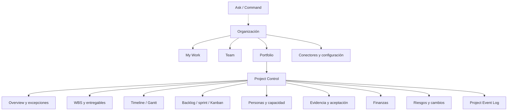

# UX/UI y arquitectura de información de Alaira Planner

**Estado:** guía de diseño conceptual; todavía no hay pantallas. Deriva del [PRODUCT_BRIEF](PRODUCT_BRIEF.md). La interfaz importa para la adopción, pero la diferenciación depende de las reglas de producto y de la fiabilidad.

## 1. Principios

- **Una verdad, muchas proyecciones:** el mismo Work Node se ve como WBS, Gantt, tabla, tablero, calendario, dashboard o chat sin cambiar su identidad. Las vistas no contienen copias del proyecto.
- **Exception-first:** la dirección ve primero lo que exige una decisión (riesgos de fecha, bloqueos, propuestas pendientes, desviaciones), no listas completas.
- **Revelación progresiva:** primero lo necesario para el rol y la metodología; el detalle técnico sigue disponible.
- **Acciones con consecuencia visible:** toda aceptación, aprobación, cambio de baseline o acción de la IA muestra quién puede actuar, qué cambiará y qué no (REQ-093).
- **Confianza:** distinguir siempre «actividad», «evidencia», «propuesta de IA», «solicitud de finalizar», «aceptado», «sincronización pendiente» y «predicción».

**Terminología:** la interfaz dice **Personas**, **Equipos**, **Capacidad** y **Recursos no humanos**; «recurso» no se usa como sinónimo de persona.

## 2. Cuatro experiencias y la barra Ask/Command (REQ-096)

| Experiencia | Para quién | Contenido |
|---|---|---|
| **My Work** | ejecutores | hoy, en progreso, esperando a alguien, necesita tu confirmación (propuestas de IA y stand-up) |
| **Team** | leads | tablero, sprint, capacidad, bloqueos, release |
| **Project Control** | PM | overview, WBS, timeline/Gantt, backlog, tablero, personas y capacidad, finanzas, riesgos, cambios, evidencia, reportes, Project Event Log |
| **Portfolio** | dirección | objetivos, programas, salud, forecast, presupuesto, hitos, dependencias entre proyectos, decisiones requeridas |

La barra **Ask/Command** está disponible en toda la aplicación, sujeta a permisos y a la política de autonomía. Ejemplos: «Muéstrame solo los paquetes que pueden afectar noviembre», «¿Qué cambió desde el steering del jueves?», «Simula agregar dos backend engineers tres semanas», «¿Cuánto dinero queda sin comprometer?», «Crea un change request para posponer Beta dos semanas».

Corte: M1 entrega Project Control y My Work mínimos y la barra para consultas y comandos de la baseline; Team llega con M2; el centro de excepciones completo y Portfolio, con M4.

La navegación cambia la prioridad según el rol, no los permisos del backend.

## 3. Vistas y riesgos de UX

| Vista | Señales esenciales | Riesgo de UX |
|---|---|---|
| Portfolio | salud, costos y fechas con fecha de corte | sumar datos no comparables |
| Overview del proyecto | excepciones, hitos en riesgo, propuestas pendientes, frescura de evidencia | volver a una lista de tareas atrasadas |
| WBS | árbol, peso, estrategia de progreso, responsable, aceptación | aparentar avance desde subtareas |
| Timeline / Gantt | baseline, forecast y real, calendario, ruta crítica | fechas falsas sin calendario |
| Backlog / tablero | prioridad, sprint, WIP, lead y cycle time | métricas individuales |
| Entregable | versiones, evidencia, criterios cumplidos y pendientes, revisor, historial | confundir «subido» con «aceptado» |
| Finanzas | gastado, comprometido, saldo gastable, forecast al final; CPI/SPI como detalle | presentar una estimación como dato real |
| Propuesta de IA | qué cambia, evidencia citada, criterios, consecuencias, nivel de autonomía | completar el objeto equivocado |
| Project Event Log | quién, qué, cuándo, por qué, evidencia, efecto | registro ilegible |

## 4. Flujos clave para prototipo

**Primer proyecto:** describir el proyecto o elegir plantilla → la IA propone WBS y backlog iniciales (agente Intake, M4; en M1, plantilla) → definir `delivery_profile` → entregables con responsable, revisor y criterios → invitar → avance inicial real 0 %.

**Evidencia a avance:** PR mergeado → EvidenceEvent vinculado → propuesta con criterios cumplidos y pendientes → confirmación del responsable en Slack o My Work → recálculo → el PM solo ve la excepción si un hito cambia de riesgo.

**Acción de IA:** propuesta citada → «ver cambios propuestos» → confirmar como actor → ejecución con permisos → resultado con consecuencias o rechazo; nunca un éxito genérico sin confirmación del servicio.

**Stand-up asíncrono (M2):** cada persona recibe su actualización sugerida a partir de la evidencia, la confirma o corrige; el PM recibe un resumen por excepciones.

**Híbrido:** fase y hito → paquete WBS → tablero del equipo → trabajo terminado → validación del entregable del gate. El estado del sprint no equivale a la aceptación de la fase; el sistema traduce el progreso adaptativo en consecuencias predictivas.

## 5. Accesibilidad, móvil y rendimiento percibido

Objetivo WCAG 2.2 AA verificable: teclado, orden de foco, nombres accesibles en arrastrar y soltar, alternativa tabular al Gantt, gráficos con datos, color nunca como única señal, contraste, errores y anuncios de estado. Web de escritorio primero; móvil para My Work, aprobaciones y actualizaciones. Mostrar carga, estado degradado y éxito confirmado por el backend.

## 6. Validación de interfaz

Pruebas con PM predictivo, PO ágil, revisor documental y finanzas: tiempo hasta el primer proyecto, errores al elegir objeto desde Slack, comprensión de las propuestas de IA, accesibilidad del flujo de aprobación y comprensión de saldo y forecast. La librería de componentes se elige en la TASK que la introduce (ADR-0006).
